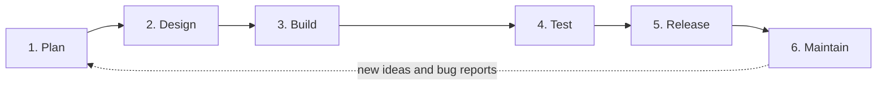

# Chapter 1: The Classic Mobile SDLC

> **In this chapter you will learn**
> - What the Software Development Life Cycle (SDLC) is, in plain language
> - The six stages every app goes through, and how teams organize them
> - Why building a mobile app is different from building a website
> - How a small team, AGMart, shipped a simple feature the old way, and where it hurt

You do not need to know how to code to read this chapter. If a term is new, it is explained where it first appears and collected in the glossary at the end.

---

## 1.1 What is the SDLC?

Imagine you want a house built. You would not call a builder and say "start laying bricks." First you decide what you need (three bedrooms, a garden). Then someone draws plans. Then the house is built, inspected, and handed over. After you move in, you keep repairing leaks and maybe add a room.

Software follows the same journey. The **Software Development Life Cycle (SDLC)** is the name for that journey, from the first idea to the day the software is retired.

It matters because most software problems are not caused by bad typing. They come from skipped steps: building before understanding what was needed, or releasing before testing. The SDLC gives a team a shared map of the steps, so everyone knows where they are and what comes next.

---

## 1.2 The six stages

Most descriptions of the SDLC list between five and eight stages. This book uses six, because that is enough to be useful and few enough to remember.

Notice the dotted arrow. The cycle never really ends. What users tell you after release becomes the plan for the next round.

| Stage | The question it answers | Example from the AGMart app |
|---|---|---|
| **1. Plan** | What are we building, and why? | Customers keep leaving because they lose their basket. We need an "Add to cart" that remembers items. |
| **2. Design** | How will it look and work? | A cart icon with a number badge, a cart screen, and a rule for what happens when an item is out of stock. |
| **3. Build** | Write the code. | Developers write the screens and the logic that stores the cart. |
| **4. Test** | Does it work? What breaks it? | Add ten items, remove them, lose the network halfway, rotate the phone. |
| **5. Release** | Put it in users' hands. | Upload the app to the app stores and let customers update. |
| **6. Maintain** | Fix, improve, repeat. | Customers report that the cart is empty after a phone restart. Fix it. |

Each stage produces something the next one needs: a plan produces requirements, design produces screens and rules, build produces code, test produces confidence (and bug reports), and release produces real users. Real users then produce the best feedback of all.

---

## 1.3 How teams organize the stages

Knowing the stages is one thing. Deciding how to run them is another. Three ideas come up constantly.

### Waterfall: finish each stage before starting the next
Picture a waterfall: water flows down one level at a time and never back up. In the waterfall approach, planning is completed fully, then design, then build, and so on.

- **Good for:** projects where requirements are fixed and well understood, such as software for regulated hardware.
- **Painful when:** something changes midway. A mistake in the plan may only be discovered at the testing stage, months later, when it is expensive to fix.

### Agile: repeat all the stages in short cycles
Agile teams do a little planning, design, build, test, and release in each short cycle, usually one to two weeks. Each cycle is called a **sprint** in a method called **Scrum**. Another method, **Kanban**, uses a board where work flows continuously without fixed cycles.

The advantage is that the team learns quickly. If the first version of a feature misses the mark, they find out in two weeks, not two years. Most mobile teams work this way.

### CI/CD: let machines handle the repetitive steps
- **Continuous Integration (CI)**: every time a developer saves a change to the shared code, a machine automatically builds the app and runs its tests. Problems show up in minutes.
- **Continuous Delivery or Deployment (CD)**: the same machine can also prepare the app for release, or release it automatically.

A **pipeline** is the name for this automated chain: change, build, test, package, deliver.

> **Not the same thing.** *DevOps* is a way of working where the people who build software and the people who run it collaborate closely. CI/CD is one of the main technical practices inside DevOps, but DevOps is also about culture and shared responsibility.

---

## 1.4 Why mobile is different from web

If you have worked on websites, parts of mobile development will feel familiar. But one difference changes almost everything.

**On the web, you control what users see. On mobile, you do not.**

When a website has a bug, the team fixes it and publishes the fix. The next time anyone opens the page, they get the corrected version. It can take minutes.

A mobile app is different, because the app lives *on the user's phone*, and there are two gatekeepers between you and that phone.

### The five realities of mobile

**1. The store sits in the middle.**
Apple's App Store and Google Play review apps before users can download them. A review can take anywhere from a few hours to several days. You cannot publish a fix instantly.

**2. Users control their own updates.**
Many people never update, or update weeks later. This means your team supports several versions of the app at the same time, and your server has to keep working with all of them.

**3. Fragmentation.**
*Fragmentation* means the huge variety of devices your app must run on. Android alone includes thousands of phone models with different screen sizes, memory, processors, and operating system versions. iPhones are more uniform, but still span several OS versions and screen sizes. A feature that works on your own phone can fail on someone else's.

**4. It is hard to undo.**
On the web you can roll back to yesterday's version. On mobile, once a build is on phones, you cannot reach in and remove it. Teams protect themselves with two techniques:
- A **feature flag** is a switch, controlled from a server, that turns a feature on or off without releasing a new app.
- A **kill switch** is a feature flag used in an emergency to turn off something that is broken.

**5. The phone is a harsh environment.**
Batteries drain. Networks drop in lifts and trains. Users deny permissions for the camera or location. Apps get interrupted by calls and notifications, and can be shut down by the operating system without warning.

### What mobile teams do about it
Because fixes are slow and mistakes are hard to undo, mobile teams invest heavily *before* release in testing, and release gradually *after*. A **staged rollout** sends the new version to a small share of users first (for example 1%, then 10%, then everyone). If problems appear, the team pauses before most users are affected. Google Play lets you choose the percentage; Apple's phased release spreads an update over about a week.

This slow, careful feedback loop is the key idea to carry into the rest of the book. Much of what agents later change is about making this loop faster and safer.

---

## 1.5 AGMart: how "Add to cart" shipped the old way

> **About AGMart.** AGMart is a fictional small e-commerce app used throughout this book, created only as a learning example. It sells home goods in Indian cities, and its customers are mostly on budget Android phones with patchy mobile data. The team is small: **Asha** (product owner), **Ravi** (Android developer), **Meera** (QA), and **Imran** (tech lead). This chapter shows the team *before* any AI agents join, so you can see the starting point.

### The goal
AGMart customers add items to a basket, then often get interrupted and lose it. Asha wants a cart that remembers items so people can return and finish buying.

### The timeline

| Day | What happened | SDLC stage |
|---|---|---|
| 1 | Asha writes a one-page requirement: "Customers can add items to a cart, see the total, and keep the cart if they close the app." | Plan |
| 2 to 3 | A designer draws the cart screen. Nobody decides what happens when an item goes out of stock between adding and buying. | Design |
| 4 to 9 | Ravi builds the cart. He tests on his own phone, a recent model. | Build |
| 10 to 12 | Meera tests by hand on three phones she owns. She finds two small bugs. Ravi fixes them. | Test |
| 13 | Imran uploads the build to Google Play. | Release |
| 14 to 15 | Store review takes two days. A planned weekend sale starts without the new cart. | Release (waiting) |
| 16 | The cart goes live to all users at once. | Release |
| 19 | Support receives reports: the cart is empty after the phone restarts, and the app crashes on some older, low-memory phones. | Maintain |
| 20 to 26 | Ravi reproduces the issue (it takes two days to find a phone that fails), fixes it, tests, and submits again. | Maintain |

### What went wrong, and why
Nothing here was done badly. The people were competent and careful. The problems came from the process itself:

1. **The unclear requirement became a bug.** "What happens when an item goes out of stock?" was never answered at the Plan or Design stage, so Ravi guessed. Users found the gap.
2. **Testing covered only the phones the team owned.** The crash on older, low-memory phones was invisible until real customers hit it. That is fragmentation.
3. **Store review blocked the sale.** Two days of waiting meant the new cart missed the weekend sale it was meant to support.
4. **Everyone got the release at once.** There was no staged rollout, so the bug reached every user before anyone noticed it.
5. **The fix cost another week.** Reproduce, fix, test, submit, wait for review, and release again, with no way to tell users to hold off in the meantime.

Total time from idea to a working, stable cart: **about 26 days**, of which fewer than 10 were spent writing code.

> **Pause and notice.** Count where the time went: waiting for review, finding a failing phone, writing the requirement a second time through bug reports. These delays are exactly what Chapter 2 examines, and exactly where the later chapters bring in agents.

---

## 1.6 A first look at where this is heading

Later in this book, Ravi starts using AI agents. His new routine looks very different from the timeline above. In outline:

1. He shares the requirement with an agent, and asks it to **ask questions and list edge cases first**, before writing any code.
2. They agree a plan for building and testing.
3. The agent builds one small piece at a time, writing tests alongside.
4. If a test fails, the agent fixes and repeats until the pieces work.
5. Each piece goes up as its own small **pull request** (a proposed change that others review), and a second agent reviews it.
6. A human, Imran, gives the final approval before anything is merged and released.

Look back at the AGMart timeline. The out-of-stock question would have been raised on Day 1. More edge cases would have been tested. And a human still decides at the key points. We do not claim agents fix everything: store review still takes two days, and a rare phone model can still fail. But the shape of the work changes. Chapter 4 gives this pattern a name, **ADLC**, and later chapters show how to build it step by step.

---

## Doubt Box

Real questions that beginners ask, answered plainly.

**Is Agile a replacement for the SDLC?**
No. The SDLC is the list of stages. Agile is a way of running those stages in small repeated loops. A team can say "we are Agile" and still go through all six stages every sprint.

**Is CI/CD the same as DevOps?**
Not quite. DevOps is a culture of building and running software together. CI/CD is one of its main technical tools.

**Why can't a mobile app just update itself like a website?**
Because the app is installed on the user's phone. The store reviews it, and the user decides when to update. A website lives on your server, which you control.

**If a feature flag can turn things off, why not use it for everything?**
Flags are powerful but add complexity: every flag is a branch in the code that must be tested and, later, cleaned up. Use them for risky or time-sensitive features, not for everything.

**We are a tiny team. Do we really need all six stages?**
You always go through them, whether you write them down or not. Skipping "plan" does not remove planning, it just means the plan lives in someone's head and gets discovered the hard way. Small teams can keep each stage light.

**Do I need to know how to code to understand this book?**
No. Some chapters show code for developers, but each explains the idea in plain language first.

---

## Key takeaways

- The SDLC is the journey from idea to retirement: plan, design, build, test, release, maintain, and around again.
- Agile runs the stages in short loops; CI/CD automates the repetitive parts.
- Mobile is different because the store and the user stand between you and your app. Fixes are slow and mistakes are hard to undo.
- Because of that, mobile teams test heavily before release and roll out gradually after.
- AGMart's first cart took about 26 days, mostly because of unclear requirements, limited device testing, and waiting.

## Try it

1. **Draw your own timeline.** Pick the last feature you shipped and write the days from idea to stable release, like the AGMart table. Mark every day you were *waiting* rather than working.
2. **Find your first guess.** Which question did your team answer by guessing instead of asking? What did the guess cost?
3. **Check your phones.** List the devices your app is tested on. Which kinds of phones are missing?

---

## Glossary for this chapter

- **SDLC:** Software Development Life Cycle, the journey from idea to retirement.
- **Waterfall:** finishing each stage before starting the next.
- **Agile:** repeating all stages in short cycles.
- **Sprint:** a fixed short cycle (often one to two weeks) in Scrum.
- **Scrum / Kanban:** two popular ways of organizing Agile work.
- **CI / CD:** continuous integration and continuous delivery or deployment; automation that builds, tests, and ships code.
- **Pipeline:** the automated chain of steps from a code change to a release.
- **DevOps:** a culture of builders and operators working together.
- **Fragmentation:** the wide variety of devices and OS versions an app must support.
- **Feature flag:** a server-controlled switch that turns a feature on or off without a new release.
- **Kill switch:** a feature flag used to quickly turn off something broken.
- **Staged rollout:** releasing to a growing percentage of users.
- **Pull request (PR):** a proposed code change that others review before it is merged.
